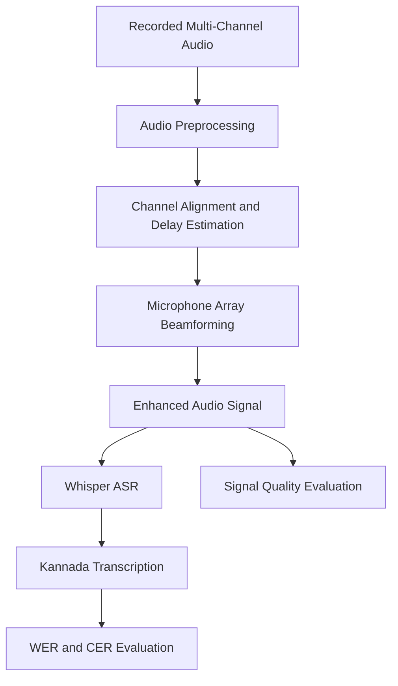

# Far-Field Speech Recognition Using Beamforming Technique for Kannada

**A software-based speech enhancement and recognition system for Kannada speech captured in far-field and noisy environments.**

## Overview

Far-field speech recognition is challenging because speech captured from a distance can be affected by background noise, reverberation, and reduced signal clarity. These factors can degrade the performance of Automatic Speech Recognition (ASR) systems.

This project explores the integration of microphone-array beamforming with a pretrained speech recognition model to improve the processing of far-field Kannada speech.

The proposed pipeline processes multi-channel audio, applies signal preprocessing and beamforming to emphasize speech from a desired direction, and passes the resulting audio to OpenAI Whisper for Kannada transcription.

The system is developed and evaluated through software-based experiments using recorded multi-channel audio under varying noise and distance conditions.

## Objectives

- Develop a software-based pipeline for far-field Kannada speech recognition.
- Process multi-channel audio using digital signal processing techniques.
- Apply microphone-array beamforming to emphasize speech arriving from a target direction.
- Integrate enhanced audio with Whisper-based Automatic Speech Recognition.
- Evaluate transcription performance under different noise and distance conditions.
- Compare the original audio input with the beamformed output using appropriate evaluation metrics.

## System Architecture



*Note: The channel-alignment and delay-estimation stages should reflect the actual implementation. Adapt this diagram if the project uses predefined delays or a different beamforming method.*

## How It Works

### 1. Multi-Channel Audio Input

The system accepts audio recorded using multiple microphone channels. Each channel captures speech with potentially different propagation delays and noise characteristics.

These spatial differences provide information that can be exploited during beamforming.

### 2. Audio Preprocessing

Preprocessing prepares the audio for subsequent signal processing.

Possible operations include:

- Loading and validating audio files.
- Checking the sampling rate and number of channels.
- Inspecting signal amplitude and clipping.
- Synchronizing channels where necessary.
- Applying suitable normalization or filtering.

The specific operations depend on the input recordings and implementation.

### 3. Microphone Array Beamforming

Beamforming combines signals from multiple microphones to emphasize sound arriving from a desired direction.

For a delay-and-sum beamformer, the output can be expressed as:

\[
y(t)=\frac{1}{M}\sum_{m=1}^{M}x_m(t+\delta_m)
\]

where:

- \(y(t)\) is the beamformed output.
- \(M\) is the number of microphone channels.
- \(x_m(t)\) is the signal from microphone \(m\).
- \(\delta_m\) is the compensation delay applied to channel \(m\).

The delays align the target speech across the microphone channels before the signals are combined.

**Implementation note:** Confirm the exact beamforming algorithm used in the project before treating delay-and-sum as the implemented method.

### 4. Kannada Speech Recognition

The processed audio is supplied to OpenAI Whisper, a pretrained multilingual speech recognition model.

Whisper converts the speech signal into text. Kannada is specified as the target language when supported by the selected model and inference configuration.

The objective is to evaluate whether spatial preprocessing improves transcription compared with the original audio.

### 5. Performance Evaluation

The system can be evaluated using:

- Word Error Rate (WER)
- Character Error Rate (CER)
- Signal-to-Noise Ratio (SNR) improvement, where a suitable clean reference is available
- Processing time and inference latency

The baseline and beamformed audio should be evaluated using the same recordings, reference transcripts, and comparable ASR settings.

## Technology Stack

| Component | Technology |
|---|---|
| Programming language | Python |
| Numerical processing | NumPy |
| Digital signal processing | SciPy |
| Audio handling | SoundFile and/or Librosa |
| Speech recognition | OpenAI Whisper |
| Visualization | Matplotlib |
| Evaluation | WER, CER and applicable signal metrics |
| Development environment | Python virtual environment |

*The libraries listed above are suggested components. Retain only those used in the actual implementation.*

## Experimental Evaluation

The project investigates the effect of beamforming on speech recognition under different acoustic conditions.

| Experimental condition | Purpose |
|---|---|
| Low-noise recording | Establish baseline performance |
| Increased recording distance | Study far-field effects |
| Increased background noise | Evaluate noise robustness |
| Combined distance and noise variation | Study performance under challenging conditions |
| Original versus beamformed audio | Measure the impact of preprocessing |

### Evaluation Metrics

**Word Error Rate (WER)**

\[
WER=\frac{S+D+I}{N}
\]

Where \(S\), \(D\), and \(I\) represent word substitutions, deletions, and insertions, respectively, and \(N\) is the number of words in the reference transcript.

**Character Error Rate (CER)**

\[
CER=\frac{S_c+D_c+I_c}{N_c}
\]

This metric measures transcription errors at the character level. Kannada text normalization and character segmentation should be applied consistently.

**Signal-to-Noise Ratio Improvement**

\[
\Delta SNR=SNR_{\text{out}}-SNR_{\text{in}}
\]

This metric is applicable when the experimental setup provides suitable reference signals and a valid method for estimating speech and noise power.

### Results

Insert measured experimental results here after running the evaluation.

| Metric | Original Audio | Beamformed Audio |
|---|---:|---:|
| WER | To be measured | To be measured |
| CER | To be measured | To be measured |
| SNR improvement | Baseline | To be measured |
| Processing time | To be measured | To be measured |

Results should be calculated from actual experiments. No performance improvement is assumed in advance.

## Project Structure

```text
project/
├── README.md
├── requirements.txt
├── docs/
├── src/
├── experiments/
├── results/
└── tests/
```

- `docs/`: Technical documentation and design decisions.
- `src/`: Audio preprocessing, beamforming, recognition, and evaluation modules.
- `experiments/`: Experiment configurations and reproducible evaluation scripts.
- `results/`: Summaries, plots, and evaluation outputs.
- `tests/`: Tests for signal-processing and software components.

## Installation

### Prerequisites

- Python 3.10 or a compatible version supported by the selected dependencies.
- Git.
- A suitable CPU or GPU, depending on the chosen Whisper model.
- Recorded multi-channel audio for testing.

### 1. Clone the repository

```bash
git clone https://github.com/<your-username>/<repository-name>.git
cd <repository-name>
```

### 2. Create a virtual environment

Windows:

```bash
python -m venv .venv
.venv\Scripts\activate
```

Linux/macOS:

```bash
python3 -m venv .venv
source .venv/bin/activate
```

### 3. Install dependencies

```bash
pip install -r requirements.txt
```

The requirements file should contain the actual dependencies and compatible versions used by the project.

## Usage

The intended workflow is:

1. Provide a valid multi-channel audio recording.
2. Run the preprocessing stage.
3. Apply the implemented beamforming algorithm.
4. Generate a Kannada transcription using Whisper.
5. Compare the output with a reference transcript.
6. Save the evaluation metrics and plots.

Add the actual execution commands here once the processing scripts and command-line interface have been finalized.

## Limitations

- Beamforming performance depends on microphone geometry, channel synchronization, and delay-estimation accuracy.
- Reverberation and interference from the same direction as the target speaker can limit enhancement.
- Whisper transcription quality varies with noise, accent, pronunciation, and recording conditions.
- Simulation-based evaluation does not by itself establish performance on physical microphone-array hardware.
- Real-time capability requires separate measurement of processing latency and computational requirements.
- Performance claims require a reproducible evaluation dataset and measured results.

## Future Enhancements

- Compare delay-and-sum beamforming with adaptive approaches such as MVDR.
- Explore direction-of-arrival estimation for speakers at different angles.
- Evaluate additional noise levels and reverberation conditions.
- Expand the Kannada test set to cover different speakers and speaking styles.
- Add automated evaluation reports and visualization tools.
- Investigate real-time processing and deployment on resource-constrained devices.

## Applications

Potential applications include:

- Kannada voice-controlled systems.
- Far-field voice interfaces.
- Meeting and conversation transcription.
- Speech accessibility systems.
- Regional-language human-computer interaction.

These are potential applications; real-world deployment requires additional validation.

## References

1. Radford, A. et al. (2023). *Robust Speech Recognition via Large-Scale Weak Supervision*. Proceedings of the 40th International Conference on Machine Learning. [Paper](https://proceedings.mlr.press/v202/radford23a.html).
2. OpenAI. *Whisper: General-purpose speech recognition model*. [GitHub repository](https://github.com/openai/whisper).
3. Include the research papers used for microphone-array beamforming, far-field speech enhancement, and Kannada speech recognition in the final bibliography.

## Author and Project Information

**Project:** Far-Field Speech Recognition Using Beamforming Technique for Kannada

**Domain:** Digital Signal Processing, Audio Signal Processing, and Speech Recognition

**Project Type:** Final-Year Engineering Project — Software-Based Simulation

**Author:** Sagar A S

**GitHub:** [https://github.com/sagar72as](https://github.com/sagar72as)

---

*This repository documents the project architecture, signal-processing methodology, speech recognition pipeline, and experimental evaluation. Implementation details and reported results should reflect the actual source code and completed experiments.*
